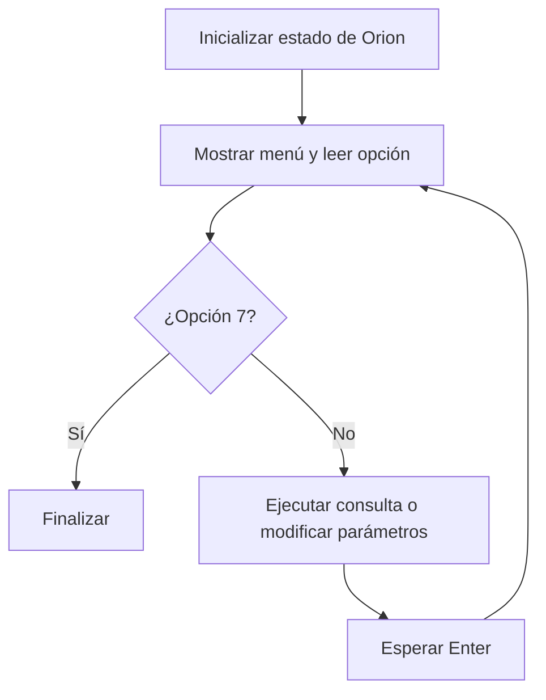

# Simulador Artemis (Lenguaje C): inyección translunar e inercia en trayectoria libre 

**Trabajo Práctico Integrador Final — Algoritmos y Estructuras de Datos**
Ingeniería en Sistemas de Información — Universidad Tecnológica Nacional, Facultad Regional Resistencia
**Escenario asignado:** situación\-problema 3, Inyección Translunar —-TLI e Inercia en Trayectoria Libre\.

## 1\. Integrantes y comisión

**Comisión: C (K1.3)

|Integrantes                      |
|---------------------------------|
|Aguirre Pintos Emmanuel Alejandro|
|De Bortoli Juan Pablo            |
|Horak Celina                     |
|López Josefina                   |
|Verón Malena                     |

## 2\. Descripción del escenario

El programa es una aplicación interactiva de consola desarrollada en C\. Representa, mediante cálculos y explicaciones, la maniobra de inyección translunar de la nave Orion\.

En el escenario propuesto, la etapa superior ICPS impulsa la nave desde una órbita terrestre baja, se desacopla y deja a Orion sin propulsión principal\. La situación propuesta sitúa a la nave en una trayectoria de retorno libre hacia la Luna, a una distancia media Tierra\-Luna de 384000 km\. El análisis aborda la primera ley de Newton, la energía cinética inicial, la variación de energía potencial gravitatoria y las diferencias energéticas entre la ida a la Luna y el regreso a la Tierra\.

El simulador se organiza como una herramienta de consulta y cálculo mediante un menú de consola\. El usuario puede explorar los conceptos del escenario y comparar resultados al cambiar la velocidad y la masa de la nave\.

**Enlace al video:** https://youtu.be/xqaGC98Qygc?si=aBie5JVgj18Ltwnq

### Parámetros iniciales

|Magnitud                   |Valor        |Unidad  |
|---------------------------|------------:|--------|
|Velocidad TLI              |10900        |m/s     |
|Masa de Orion              |26000        |kg      |
|Altitud inicial LEO        |192000       |m       |
|Radio terrestre medio      |6371000      |m       |
|Masa de la Tierra          |5.972 × 10²⁴ |kg      |
|Constante gravitatoria G   |6.674 × 10⁻¹¹|N·m²/kg²|
|Distancia media Tierra-Luna|384000000    |m       |

La velocidad y la masa pueden modificarse desde el menú\. La altitud se mantiene en su valor inicial durante la ejecución de esta versión\.

## 3\. Funcionamiento y reglas de uso

El menú se repite hasta seleccionar la opción 7\. Cada operación utiliza los parámetros actuales de la nave\. Después de una operación, se solicita presionar Enter para volver al menú\.

|Opción|Acción implementada                                                                                                 |
|------|--------------------------------------------------------------------------------------------------------------------|
|1     |Muestra los parámetros y ejecuta los cálculos de energía cinética y diferencia de potencial gravitatorio específico.|
|2     |Presenta una explicación sobre la primera ley de Newton.                                                            |
|3     |Calcula y guarda la energía cinética inicial.                                                                       |
|4     |Calcula y guarda la diferencia de potencial gravitatorio específico entre LEO y una posición estimada.              |
|5     |Presenta una explicación energética sobre el combustible de ida y regreso.                                          |
|6     |Permite cambiar velocidad y masa dentro de los rangos admitidos.                                                    |
|7     |Finaliza la ejecución.                                                                                              |

La opción 1 reúne la presentación de parámetros y los dos cálculos numéricos\. Las explicaciones conceptuales se consultan desde las opciones 2 y 5\.

Los cambios de parámetros y los resultados se conservan en memoria durante la ejecución\. No se guardan en archivos y se pierden al cerrar el programa\.

## 4\. Organización del proyecto

El proyecto se distribuye en archivos fuente y de cabecera con responsabilidades diferenciadas:

|Archivo         |Responsabilidad                                                                      |
|----------------|-------------------------------------------------------------------------------------|
|`main.c`        |Inicialización de la nave, menú, selección de opciones y actualización de parámetros.|
|`artemis.h`     |Constantes, definición de `EstadoTLI` y prototipos de funciones.                     |
|`artemis.c`     |Cálculos físicos, coordinación de cálculos y explicaciones del escenario.            |
|`validaciones.h`|Prototipos de lectura de enteros y números de punto flotante.                        |
|`validaciones.c`|Lectura de entradas y comprobaciones de conversión y rango.                          |

### Flujo general



### Estructuras y recursos de programación

La estructura `EstadoTLI`, declarada con `typedef struct`, reúne velocidad, masa, altitud, energía cinética y el resultado del cálculo de trabajo específico\.

Las funciones de cálculo reciben un puntero `EstadoTLI *nave`\. En `main`, se pasa la dirección con `&nave`; dentro de las funciones se accede a sus campos con `->`\. Esto permite actualizar la estructura original sin devolver una copia completa\.

Se emplean `switch` e `if` para las decisiones, `do...while` para el menú y `while (1)` para repetir el ingreso hasta aceptar un valor\. En las validaciones se utiliza el arreglo de caracteres `buffer[100]` para almacenar la línea leída con `fgets`\. No se utiliza asignación dinámica de memoria\.

## 5\. Fundamentos y cálculos implementados

### Energía cinética inicial

Se aplica:

`K = 0.5 * m * v²`

Con los valores iniciales, el resultado es **1 544 530 000 000 J**\. La función `calcular_energia_cinetica` guarda el resultado en `energia_cinetica`\.

### Potencial gravitatorio específico

El código utiliza el potencial terrestre por unidad de masa:

`u(r) = -G * M_TIERRA / r`

El radio inicial es `r_LEO = R_TIERRA + altitud_inicial`\. La posición final se estima como `r_eq = 0.9 * DIST_LUNA`\. Luego calcula:

`delta_u = u(r_eq) - u(r_LEO)`

Con los parámetros iniciales obtiene aproximadamente **59 576 770\.81 J/kg**, que guarda en `trabajo_ext_masa`\.

La función `calcular_trabajo_equilibrio` utiliza esta diferencia de potencial específico para el análisis energético del desplazamiento\. La posición final adoptada por el programa es una aproximación equivalente al 90 % de la distancia media Tierra\-Luna\.

### Inercia y combustible

La primera ley de Newton establece que la velocidad permanece constante cuando la fuerza externa neta es nula\. Tras apagar los motores, Orion continúa en movimiento y permanece sometida a la atracción gravitatoria, cuya magnitud depende de la distancia\.

El módulo presenta una comparación cualitativa entre los pozos gravitatorios terrestre y lunar para explicar las diferencias energéticas entre el viaje de ida y el regreso\.

## 6\. Compilación y ejecución

Se requiere GCC o un compilador compatible con C y la biblioteca matemática estándar\. Desde la carpeta que contiene los cinco archivos:

```bash
gcc -std=c11 -Wall -Wextra -pedantic main.c artemis.c validaciones.c -o artemis -lm
```

En Linux o macOS:

```bash
./artemis
```

En Windows con GCC/MinGW, compilar y ejecutar desde PowerShell con:

```powershell
gcc -std=c11 -Wall -Wextra -pedantic main.c artemis.c validaciones.c -o artemis.exe -lm
.\artemis.exe
```

La opción `-lm` enlaza la biblioteca matemática utilizada por `pow`\. Los cinco archivos del proyecto deben estar en la misma carpeta al ejecutar el comando de compilación\.

## 7\. Validaciones de entrada

|Entrada        |Rango admitido                   |
|---------------|---------------------------------|
|Opción del menú|Entero entre 1 y 7               |
|Velocidad TLI  |Entre 5000 y 25000 m/s, inclusive|
|Masa           |Entre 1000 y 100000 kg, inclusive|

Las funciones leen con `fgets`, convierten con `sscanf` y verifican el rango\. Si la conversión falla o el valor queda fuera de rango, muestran un mensaje y repiten el ingreso\. Para decimales, utilizar punto, conforme a la configuración inicial habitual de C\.

## 8\. Ejemplo de uso

1. Compilar el proyecto y ejecutar el programa\.
2. Seleccionar la opción 1 para consultar los parámetros iniciales y los resultados de los cálculos\.
3. Presionar Enter para regresar al menú\.
4. Elegir la opción 6 e ingresar una velocidad de `10000` m/s y una masa de `20000` kg\.
5. Presionar Enter para volver al menú y seleccionar la opción 3: la energía cinética correspondiente a esos parámetros es `1000000000000` J\.
6. Regresar al menú con Enter y consultar las explicaciones mediante las opciones 2 y 5, volviendo al menú después de cada consulta\.
7. Elegir la opción 7 para salir\.

Los resultados se presentan en la consola y se almacenan en los campos correspondientes de `EstadoTLI` cuando se ejecuta cada cálculo\.

## 9\. Uso de inteligencia artificial

**Herramienta utilizada:** ChatGPT\.

Se utilizó como apoyo para aclaraciones sobre el proyecto y la organización de su documentación\.

### Preguntas técnicas

|Tema                  |Pregunta                                                       |
|----------------------|---------------------------------------------------------------|
|Paso de parámetros    |¿Cómo pasar una estructura a una función mediante un puntero?  |
|Acceso a estructuras  |¿Por qué se usa `->` para acceder a los campos de `EstadoTLI`? |
|Validación de entradas|¿Cómo comprobar que un valor ingresado esté dentro de un rango?|
|Compilación           |¿Para qué sirve `-lm` al compilar?                             

## 10\. Video de presentación

**Enlace al video:** https://youtu.be/xqaGC98Qygc?si=aBie5JVgj18Ltwnq
